# Seoul, Curated — 프로젝트 기록

> 서울관광재단 제안용 개인 맞춤형 서울 여행 사이트 (콘셉트 제안 프로젝트, 공식 서비스 아님)
>
> - 사이트: https://my-seoul-curated.netlify.app
> - 기간: 2026년 9월 24일 ~ 11월 (약 2개월)
> - 팀: 경기대학교 6명
> - 저장소: 이 저장소 (`v1.0` 태그 = 제출 시점 버전)

---

## 1. 한 줄 요약

**"유명한 곳이 아니라, 나와 닮은 동네에서 시작하는 서울."**

외국인 여행자가 12문항 성향 테스트로 서울 12개 구 중 자신과 맞는 구를 추천받고, 그 구의 하루 코스를 따라가며, 메타버스에서 다른 여행자와 그 동네를 미리 걸어 보는 사이트.

## 2. 문제 정의

- 기존 관광 정보는 나열형이라 여행자가 직접 골라야 하고, 결국 누구나 아는 몇 곳에 몰린다.
- 외국인이 "서울 사람들이 실제로 사는 서울"을 깊게 경험할 길잡이가 부족하다.

→ **나를 먼저 묻고(테스트), 동네를 건네고(구 매칭), 하루를 안내하고(코스), 미리 걸어 보게(메타버스) 한다.**

## 3. 사이트 구성

| 페이지 | 하는 일 | 설계 의도 |
|---|---|---|
| 홈 | 스크롤에 맞춰 서울의 낮→밤, 남산타워로 다가가는 영상 | 첫 화면에서 "서울에 왔다"는 감정을 만들고 바로 테스트로 연결 |
| 테스트 | 12문항 2지선다 → 16가지 여행 유형 → 맞는 구 1·2순위 | 나를 먼저 묻는다 |
| 서울, 12개의 지역 | 12개 구 하루 코스 (시간·비용·이동·정보 확인일) | 유명 관광지보다 시장·골목·노포 중심 |
| 서울 이야기 | 2천 년 역사를 7장면 타임라인으로 | 역사를 지금 가볼 장소·코스와 연결 |
| 메타버스 | 5개 구를 3D로 걸으며 다른 여행자와 만나기 | 가기 전에 동네 분위기를 미리 체험 |
| 통계 (`/stats`, 비공개 주소) | 테스트 결과 누적 통계 | 제안 효과를 숫자로 확인 |

## 4. 핵심 기능과 구현 방식

### 4-1. 홈 스크롤 영상
- AI로 생성한 영상 클립 2개(낮→밤, 남산타워 확대)를 **사진 180장**으로 나눠, 스크롤 위치에 맞는 사진을 캔버스에 그린다. 스크롤을 내리는 만큼 영상이 앞뒤로 움직인다.
- 첫 방문 때 "당신을 위한 서울을 소개합니다" 로딩 화면이 영상 사진을 모두 받을 때까지 기다린다(진행선 표시, 최대 10초).
- 휴대폰에는 세로 영상, 컴퓨터에는 가로 영상을 따로 보낸다.

### 4-2. 성향 테스트와 매칭
- 여행 성향을 네 축으로 본다: **전통↔트렌드, 골목↔탁 트인 곳, 차분함↔북적임, 머무름↔많이 다님**.
- 질문마다 축에 점수를 더하거나 빼고, 네 축의 방향을 조합해 16가지 유형을 만든다(예: TACF 공방 순례자).
- 12개 구에도 같은 네 축의 성향 점수를 매겨 두고, 내 점수와 가장 가까운 구를 1·2순위로 추천한다.

### 4-3. 하루 코스 · 서울 이야기
- 팀 조사 자료로 구마다 하루 코스(5~7곳)를 만들고 시간·비용·이동·정보 확인 날짜를 넣었다.
- 장소 사진은 공개 라이선스 사진을 쓰고 출처를 표기했다.
- 서울 이야기는 팀 조사 문서를 7장면으로 압축하고, 장면마다 지금 가볼 장소와 해당 구 코스로 연결했다.

### 4-4. 메타버스
- 3D 모델을 사거나 생성하지 않고 **건물·나무·캐릭터를 전부 코드로 그렸다**(아기자기한 생활 게임 느낌의 그림체).
- 방 5개, 계절·시간대를 겹치지 않게 구성:
  - 서대문 안산 자락길(가을 낮), 용산 해방촌(가을 오후), 종로 서순라길(가을 저녁), 강남 영동대로·봉은사(가을 밤), 영등포 문래 철공소 골목(비 오는 저녁)
- 같은 방 사람들이 실시간으로 보이고(방마다 30명), 채팅·자동 번역·이모트를 쓸 수 있다.
- 방마다 그 동네다운 **공유 상호작용**(누군가 하면 모두의 화면에 보임):
  - 종로 소원 등 달기 · 서대문 약수터·돌탑·까치 · 용산 호떡·고양이·경사형 엘리베이터 · 강남 횡단보도 버튼·말춤·범종·파도 · 영등포 용접·모루·셔터 갤러리
- 입장 전 옷장에서 성별·옷(한복 등)·머리·소품을 골라 캐릭터를 꾸민다.

### 4-5. 테스트 통계
- 테스트를 마칠 때마다 개인정보 없이 결과 한 줄(유형, 추천 구 1·2순위, 12문항 답, 언어, 기기)을 저장한다.
- 사이트는 기록을 **추가만** 할 수 있고, 통계 페이지는 합계만 받아 온다.

## 5. 기술 구성

| 역할 | 사용 기술 | 비유 |
|---|---|---|
| 사이트 뼈대 | Next.js (React, TypeScript), 정적 파일로 내보내기 | 건물의 골조 |
| 3D 메타버스 | Three.js (React Three Fiber) | 무대와 소품을 코드로 짓는 도구 |
| 실시간 연결·데이터 | Supabase (Realtime, Postgres, 서울 리전) | 방문자끼리 잇는 교환기 + 기록 보관함 |
| 코드 보관 | GitHub | 설계 도면 보관소 |
| 배포 | Netlify | 도면대로 지어 인터넷에 공개 |

수정 흐름: 작업 브랜치 → PR → 미리보기 빌드 확인 → main 합치기 → Netlify 자동 배포(1~2분).

## 6. 진행 과정

1. **기획·방향 (9월 말~)** — 대상(외국인 개인 여행자)과 흐름(테스트→구→코스→메타버스) 확정. 디자인 방향 "백자와 서울의 빛" 선택(목판·민화 시안 탈락).
2. **테스트·코스** — 문항·유형 한영 작성, 12개 구 하루 코스.
3. **홈** — 스크롤 영상, 안내 문구, 로딩 화면.
4. **메타버스 (11월 중순~)** — 실사풍 3D가 어색해 코드로 그리는 그림체로 전환. 종로→서대문→용산→강남→영등포 순으로 확장.
5. **다듬기** — 모바일 정리, 줄바꿈 규칙, 성능 최적화, 오류 수정 반복.
6. **배포 (11월 22일)** — GitHub → Supabase → Netlify 연동, 테스트 통계 추가.

## 7. 문제 해결 사례

| 문제 | 원인 | 해결 | 결과 |
|---|---|---|---|
| 홈 첫 스크롤 버벅임 | 영상 사진을 다 받기 전에 스크롤이 앞서감 | 300→180장으로 줄이고, 다 받을 때까지 로딩 화면 | 휴대폰 첫 스크롤 멈칫함 88% → 0% |
| 영상이 지지직거림 | 흐린 임시 이미지와 선명한 이미지가 번갈아 보임 | 항상 선명한 프레임만 표시 | 흐린 프레임 0회 |
| 아이폰 하단이 잘림 | 새 사파리의 떠 있는 탭바 | 화면 끝까지 영상을 채우고 버튼은 탭바 위로 | |
| 메타버스 6명 이상에서 버벅임 | 캐릭터 부품을 하나씩 그림 | 부품을 한 덩어리로 합치고 휴대폰은 화질 단계 낮춤 | 11명 기준 그리기 횟수 약 130~300회 |
| 넷리파이에서만 페이지 오류 | 넷리파이가 페이지에 주석을 끼워 넣음 | 화면 시작 전 그 주석만 제거 | 오류 0건 |

## 8. 디자인 원칙

- 백자처럼 밝고 차분한 색, 한국 전통은 장식이 아니라 구조로 녹인다.
- 줄바꿈 규칙: 단어 중간, 문장 앞 한두 단어에서 줄이 바뀌지 않도록 휴대폰·태블릿·컴퓨터에서 검사.
- 모바일 전용 배치(세로 타임라인, 사진 카드, 고정 입장 버튼).
- 접근성: "움직임 줄이기" 설정 시 영상 대신 정지 화면, 키보드로 테스트 진행 가능.

## 9. 검증

- 자동 테스트 93개 (매칭 계산, 코스 데이터, 메타버스 경로·채팅 필터 등)
- 24개 페이지 × 데스크톱·휴대폰 × 한국어·영어 전체 순회 (오류·깨진 링크·가로 넘침)
- 메타버스 방마다 충돌·좌석·상호작용 자동 점검, 휴대폰 성능 측정
- 실제 배포 사이트에서 실시간 연결·통계 저장 확인

## 10. 숫자로 보기

- 12문항 · 16가지 여행 유형 · 12개 구 하루 코스
- 서울 역사 7장면
- 메타버스 방 5개, 방마다 30명, 공유 상호작용 15개 이상
- 약 2개월, 커밋 110여 회, 코드 약 2만 줄

## 11. 표기와 출처

- 서울관광재단의 공식 서비스가 아닌 제안 프로젝트이며, 사이트에 표기되어 있다.
- 홈 영상은 AI 생성 이미지이며 사이트에 표기되어 있다.
- 장소 사진은 공개 라이선스 사진으로, 사진마다 작가와 라이선스를 표기했다.

## 12. 기록 보관

- `docs/screenshots/` — 주요 화면 스크린샷 (데스크톱·휴대폰)
- Git 태그 `v1.0` — 제출 시점 소스
- `site-v1.0` 브랜치 — 빌드된 사이트 파일 그대로(정적 호스팅에 올리면 바로 열림)
- 테스트 통계 원본 — 모집 종료 후 Supabase `test_results` 표를 CSV로 내려받아 보관할 것

## 13. 화면

| 컴퓨터 | 휴대폰 |
|---|---|
| 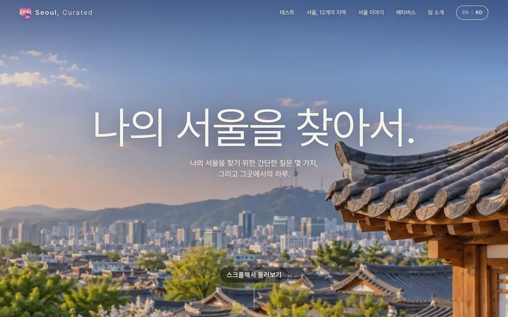 | 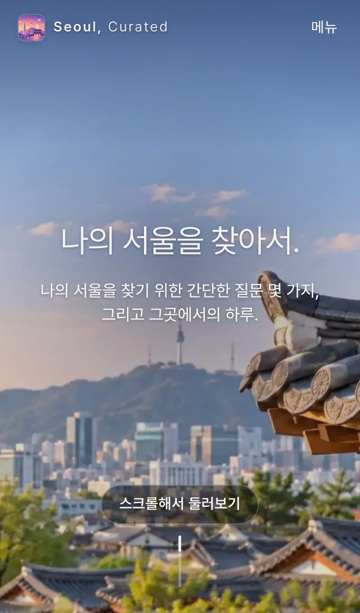 |
| 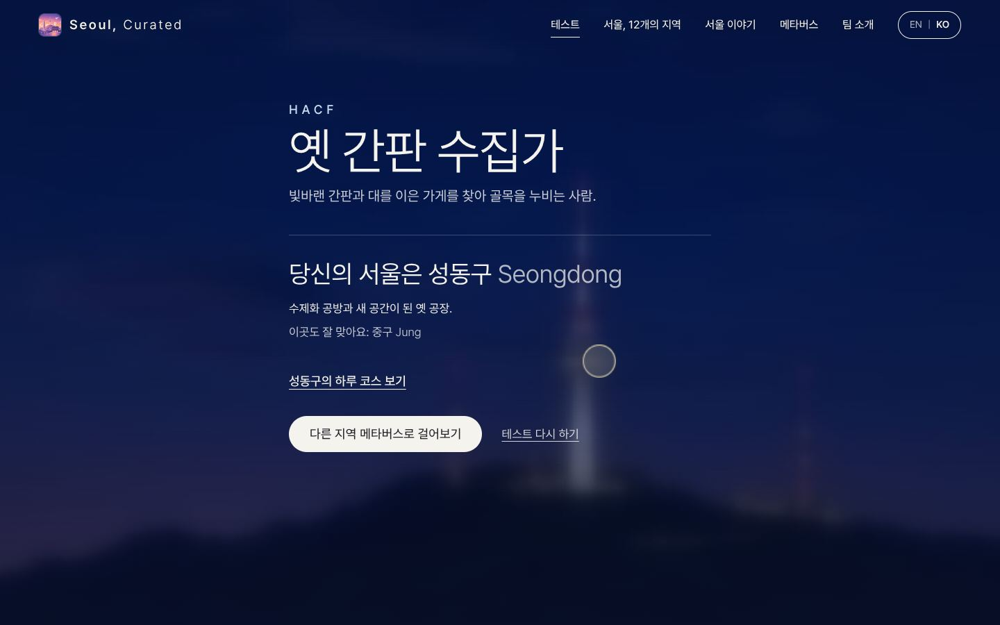 | 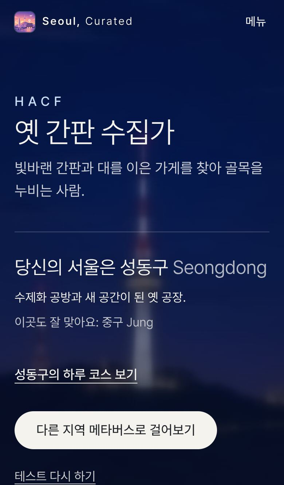 |
| 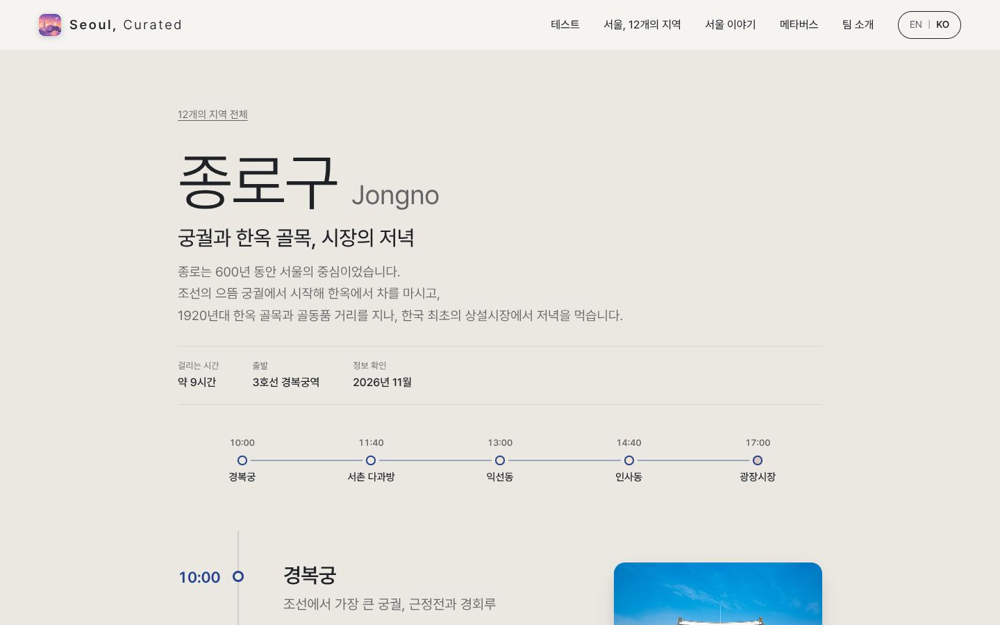 | 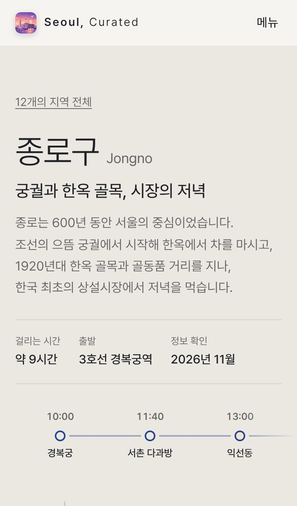 |
| 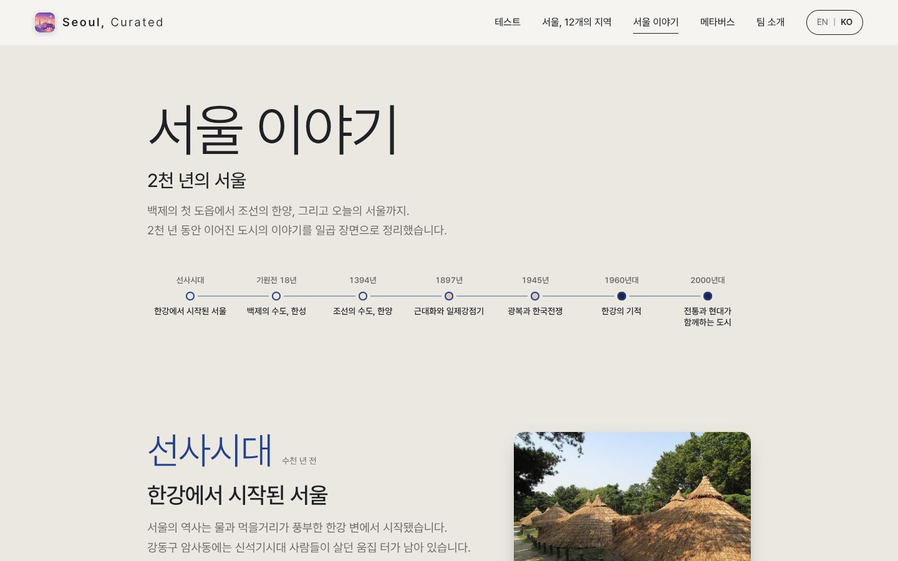 | 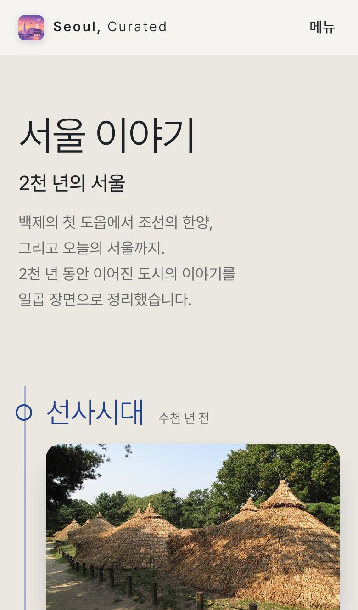 |
| 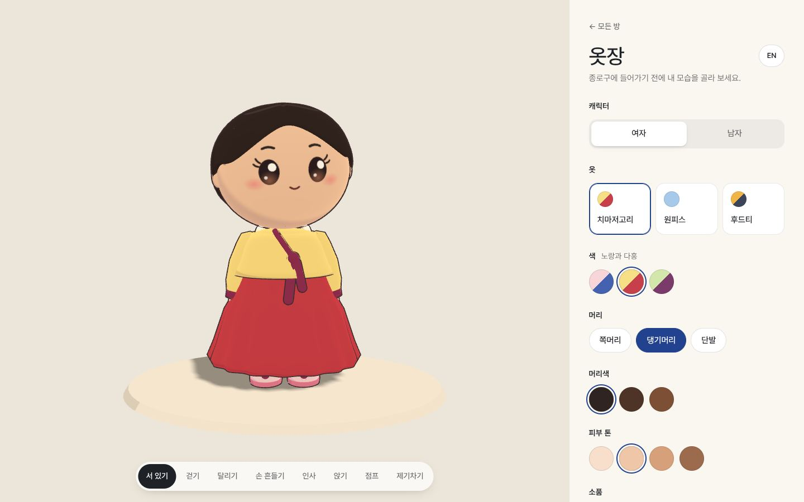 | 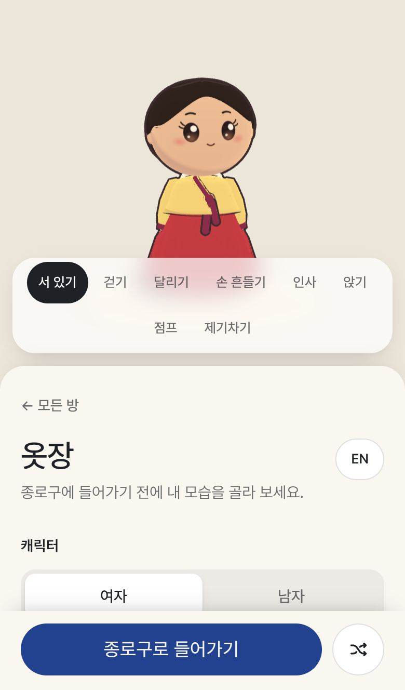 |
| 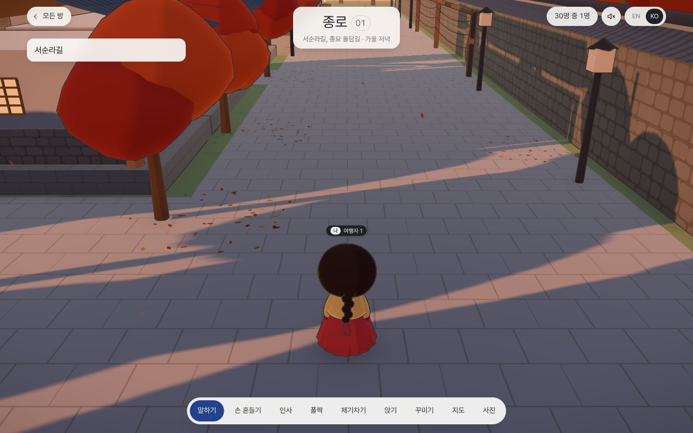 | 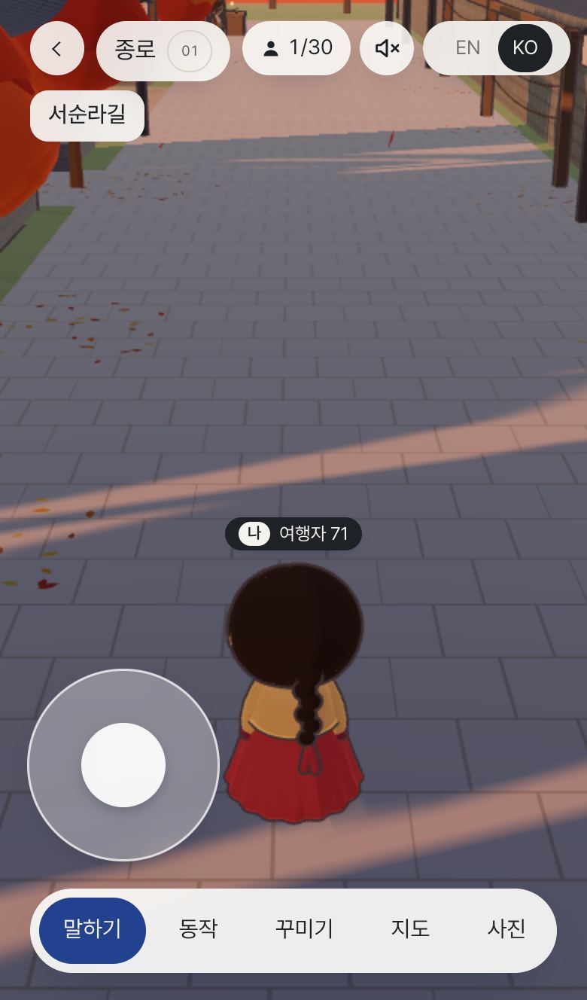 |

메타버스 방 5개:

| 서대문 | 용산 | 강남 | 영등포 |
|---|---|---|---|
| 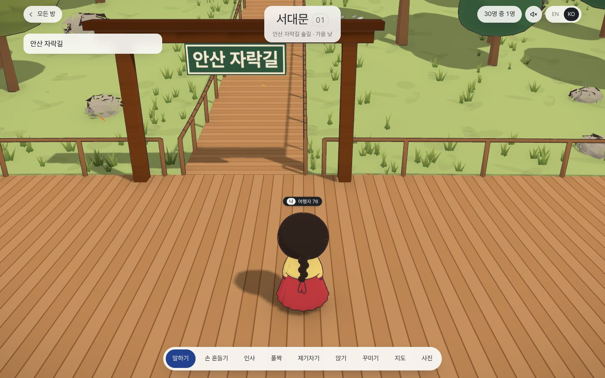 | 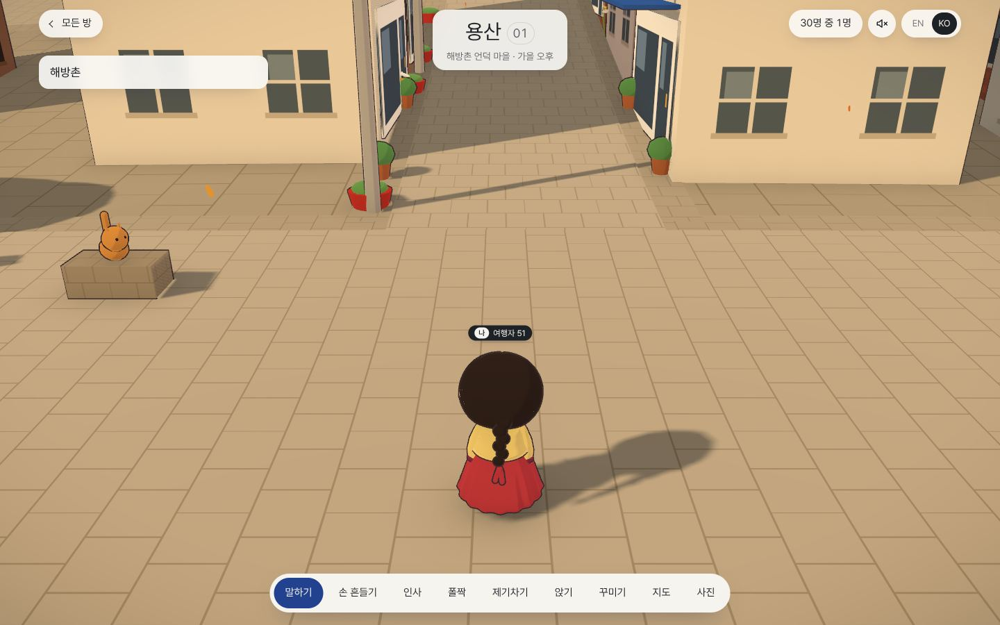 | 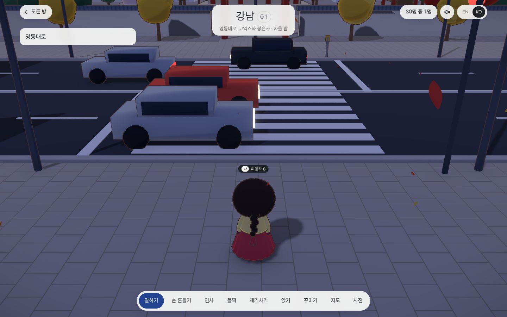 | 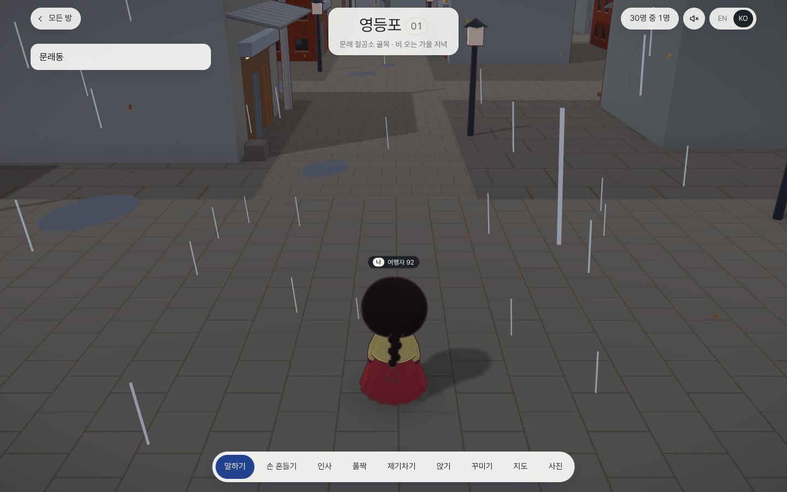 |

전체 화면(컴퓨터 16장, 휴대폰 12장)은 `docs/screenshots/`에 있다. 2026년 11월 26일 촬영.
